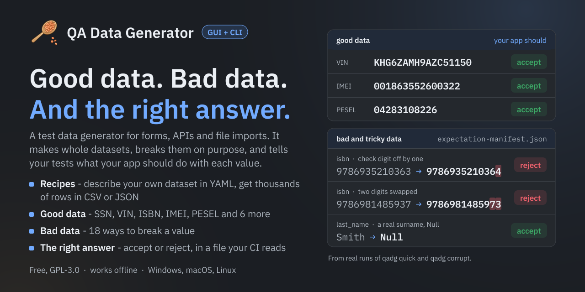

# QA Data Generator - good test data, bad test data, and the right answer for each
<p align="center">
  <b>Follow me:</b>
  &nbsp
  <a href="https://discord.gg/bDTu8HX"></a>
  &nbsp
  <a href="https://facebook.com/donislawdev"></a>
  &nbsp
  <a href="https://x.com/donislawdev"><picture><source media="(prefers-color-scheme: dark)" srcset="https://cdn.simpleicons.org/x/FFFFFF"></picture></a>
  &nbsp
  <a href="https://bsky.app/profile/donislawdev.bsky.social"></a>
  &nbsp
 <a href="https://store.steampowered.com/developer/DonislawDev"><picture><source media="(prefers-color-scheme: dark)" srcset="https://cdn.simpleicons.org/steam/FFFFFF"></picture></a>
</p>

[](LICENSE)


**QA Data Generator** makes test data for QA engineers and developers, and then breaks it on purpose.

You describe your tables in a short YAML recipe, say a thousand customers with up to five payments
each, and get them as CSV or JSON. The values agree with each other: first names fit the gender
column, the city, state and ZIP code belong together, and every card number, ISBN or VIN carries a
correct check digit. Data like that gets past your validation instead of failing on the first screen.

Then it breaks the data, a dataset it made or a CSV file you already have, and writes a manifest
beside it. For every value it changed, the manifest says what your application should do with it:
reject the card number whose check digit is off by one, accept the customer called O'Brien. Your test
reads the answer from that file instead of you writing it by hand. A desktop window and a command
line, over one engine.

⭐ **If it found a bug before your users did, leave a star.** That is how the next tester who needs it
finds out it exists.

**What it can do**

- **Whole datasets from a recipe** - describe your tables, how many rows each one has and how they
  relate, in one YAML file. A customer can have zero to five payments, every payment points at its
  customer, and one command writes all of them.
- **Values that agree with each other** - a first name fits the gender, a city, state and ZIP code
  belong together, and a Polish national ID number carries the same birth date and gender as the
  columns beside it.
- **Identifiers that pass validation** - card numbers, ISBN, EAN, IMEI, VIN, US social security and
  routing numbers, and national numbers for Poland, all with correct check digits. Card numbers are
  only the published test numbers.
- **Damage on purpose, with the answer** - a check digit off by one, two digits swapped, a value
  longer than its column allows, an empty required field, an emoji, an invisible zero-width space.
  Each damaged value goes into the manifest with what your application should do about it.
- **Valid values your app may wrongly refuse** - O'Brien, José, 美咲 and the surname Null are real
  names, and the manifest says they should be accepted. A false rejection turns away a real customer.
- **Damage a file you already have** - point `qadg corrupt` at a CSV file. It works out what each
  column holds by looking at the values, says why it decided so, and lists what it could not work
  out rather than guessing.
- **Check what your app did** - `qadg verify` compares the manifest with a record of what your
  application did with each row, lists every row where the two disagree, and ends with an exit code
  your pipeline can fail on.
- **Same seed, same data** - the same recipe and seed give the same rows and the same damage, byte
  for byte, on any machine. Commit a small recipe instead of large fixture files.
- **Answers your tests can read** - the manifest is JSON, and can also be written as a Gherkin
  Examples table, as CSV or as Markdown.
- **One value in a second** - `qadg quick vin` prints one valid VIN, and `--count 1000` prints a
  thousand.
- **Careful with your files** - a run writes nothing until it has succeeded, an existing file stops
  it unless you add `--overwrite`, and the file you give `qadg corrupt` is never written over.
- **Offline, free, no telemetry** - GPL-3.0, no account, no network connection. The data you
  generate is yours.

<p align="center">
  
</p>

---

## Two minutes with it

### One value

<!-- readme-check: run -->
```
qadg quick vin --count 3 --seed readme
```

<!-- readme-check: output -->
```
1BYT5FU9749011245
C2W0U46N5PEY89060
BFXUMNKG544D46596
```

Without `--seed` every run draws new values. With it, the same values come back every time.
`qadg help generators` lists everything this build can make.

### A whole dataset

Save this as `shop.yaml`:

<!-- readme-check: file shop.yaml -->
```yaml
version: "0.1"
seed: "readme"
locale: en-US

entities:
  customer:
    count: 1000
    primary_key: ssn
    fields:
      first_name: { generator: first_name, required: true }
      last_name:  { generator: last_name, required: true, max_length: 30 }
      gender:     { generator: gender }
      birth_date: { generator: birth_date }
      ssn:        { generator: ssn, unique: true }
      city:       { generator: city }
      state:      { generator: region }
      zip:        { generator: postal_code }
      plan:       { values: [free, pro, team] }
    consistency:
      - first_name matches: [gender]

  payment:
    belongs_to: { customer: 0-5 }
    fields:
      card: { generator: card }

output:
  format: csv
  dir: ./data
  file_per_entity: true
```

Check it, then run it:

<!-- readme-check: run -->
```
qadg validate shop.yaml
qadg generate shop.yaml
```

<!-- readme-check: output 1 -->
```
       customer: state follows city, though no rule says so
       customer: zip follows city and state, though no rule says so
shop.yaml can be used. Understood 2 entities and 10 fields.
A run of it would write 3524 rows in 2 tables.
```

`data/customer.csv` starts like this:

<!-- readme-check: head data/customer.csv -->
```
first_name,last_name,gender,birth_date,ssn,city,state,zip,plan
Joel,Cook,male,1936-11-30,666-18-0253,Saginaw,MI,48601,team
Brady,Santos,male,1985-10-04,666-18-1470,Tryon,NC,28782,pro
Marco,Richardson,male,1966-05-07,666-30-3256,Porterville,MS,39352,free
```

and `data/payment.csv` like this, each payment carrying the key of its customer:

<!-- readme-check: head data/payment.csv -->
```
card,customer
6243030000000001,666-18-0253
378282246310005,666-18-0253
371449635398431,666-18-0253
```

- `belongs_to: { customer: 0-5 }` gives each customer zero to five payments.
- `matches` keeps first names in line with the gender column. City, state and ZIP code agree
  without a rule, and `validate` says so.
- `required` and `max_length` describe your columns. They also tell the damage below what to break.
- `seed` makes the run repeatable. Change it for different data of the same shape.

### Break it on purpose

Add three lines to the recipe:

<!-- readme-check: append shop.yaml -->
```yaml
policy:
  layers: [L2, L3, REV]
  rows: 5%
```

and run it again, asking for the manifest as a Markdown table too:

<!-- readme-check: run -->
```
qadg generate --overwrite --manifest markdown shop.yaml
```

The data comes out as before, with damage in 5% of the rows, and beside it is
`expectation-manifest.json`. A few of its entries:

<!-- readme-check: defects data/expectation-manifest.json -->
| Record | Column | Before | After | Your app should |
|---|---|---|---|---|
| payment 233 | card | `6011111111111117` | `6011111111111118` | reject |
| payment 276 | card | `4242424242424242` | `4244224242424242` | reject |
| customer 256 | last_name | `Nash` | `Nashhhhhhhhhhhhhhhhhhhhhhhhhhhh` | reject |
| customer 247 | ssn | `666-81-7154` | `000-81-7154` | ~ reject |
| customer 229 | last_name | `Walker` | empty | ~ reject |
| customer 151 | last_name | `Dunlap` | `D'Arcy` | accept |
| customer 226 | first_name | `Howard` | `翔太` | accept |
| customer 330 | last_name | `Phelps` | `Null` | accept |

`~` marks an answer that depends on the rules of your own application. `qadg verify` reports a
disagreement on one of those and does not fail on it.

### A file you already have

<!-- readme-check: fixture customers.csv -->
<!-- readme-check: run -->
```
qadg corrupt --layers L2,L3,UNI,REV --seed readme customers.csv
```

<!-- readme-check: output -->
```
customers: 1000 rows, 6 columns, nothing declared what any of them holds
       first_name taken for a column of string values, because no numbering scheme this build carries accepted 1000 values of this column, and its header is one this build reads as naming given names
       ...
       card taken for a column of card values, because every one of 1000 values of this column was accepted by the card validator, and by no other scheme carrying a check digit
...
customers.corrupted.csv and expectation-manifest.json written to .
46 defects ordered, 15 applied, manifest in expectation-manifest.json
...
```

Your file stays as it was. The damaged copy is `customers.corrupted.csv`. `--layers` is required, so
you always choose what to attack. `--rows` sets the share of rows to damage, 5% unless you say
otherwise. `--dry-run` shows what it worked out and what it would damage, and writes nothing.

### Check what your app did

Import `customers.corrupted.csv` into your application and write down what it did with each row,
one entry per row. A few lines at the end of your test can write it. Three of the entries:

<!-- readme-check: response response.json customers.corrupted.csv -->
```json
{
  "spec_version": "0.2",
  "rows": [
    { "row": 134, "verdict": "accepted" },
    { "row": 135, "verdict": "accepted" },
    { "row": 432, "verdict": "rejected", "code": "INVALID_NAME" }
  ]
}
```

<!-- readme-check: run exit=4 -->
```
qadg verify expectation-manifest.json response.json
```

<!-- readme-check: output -->
```
compared 15 entries against what the application did
warning: row 135, card: accepted although it should have been rejected. The value was taken. ...
warning: row 432, last_name: rejected although it should have been accepted. The application answered INVALID_NAME
...
```

It ends with exit code 4. Row 135 is a card number with two digits swapped that got in, and row 432
is O'Brien, who was turned away. The whole format of that record is in
[spec/application-response.md](spec/application-response.md).

### In the window

`qadg-gui` puts the same engine in a window, with four screens for the work:

- **Quick value** - pick what to generate and get ten values to copy.
- **Recipe** - write or paste a recipe. It is checked as you type, shows what it describes, and runs
  when you ask.
- **Damage a file** - open a CSV file, see what each column holds and why, pick what to damage, see
  what would happen, then run it.
- **Check results** - open a manifest, go through every ordered defect, and compare it with what your
  application did.

---

## Build it from source

You need [Go](https://go.dev/dl/) 1.27.4 or newer.

```
git clone https://github.com/donislawdev/qadatagenerator
cd qadatagenerator
go build ./cmd/qadg
go build ./cmd/qadg-gui
```

The first line builds `qadg`, the command line, and needs nothing but Go. The second builds
`qadg-gui`, the window, which also needs a C compiler and the OpenGL headers:

| System | What to install first |
|---|---|
| Windows | a MinGW-w64 `gcc` on your `PATH` |
| macOS | the Xcode command line tools, `xcode-select --install` |
| Debian or Ubuntu | `sudo apt-get install gcc libgl1-mesa-dev xorg-dev libwayland-dev libxkbcommon-dev` |

---

## What it generates

<!-- readme-check: generators -->
| Generator | Makes |
|---|---|
| `first_name`, `last_name`, `gender`, `birth_date` | people. First and last names can follow the gender column |
| `city`, `region`, `postal_code` | places that belong together. In `en-US` a region is a state and a postal code is a ZIP code |
| `card` | card numbers, only from the published test numbers |
| `isbn`, `ean`, `imei`, `vin` | book numbers, barcodes, mobile phone identities and vehicle identification numbers |
| `ssn`, `aba` | US social security numbers and bank routing numbers |
| `pesel`, `nip`, `regon`, `iban` | Polish national ID, tax and business numbers, and Polish bank account numbers |

Every identifier comes with a correct check digit. Names, cities and regions come from word lists for
`en-US` and `pl-PL`, and `--locale` or `locale:` in a recipe picks one. `qadg help generators` prints
the same list from the program itself.

---

## What it breaks

Damage comes in groups. The window shows the name, `--layers` and `layers:` take the code.

<!-- readme-check: layers -->
| Group | Code | What it does to a value | Your app should |
|---|---|---|---|
| Field format | `L2` | makes it longer than its column allows, empties a required field, puts letters in a number | reject |
| Value meaning | `L3` | moves a check digit by one, swaps two digits, takes a number from a block that is never issued | reject |
| Rules between fields | `L4` | makes a Polish national ID number disagree with the birth date or gender beside it | reject |
| Unicode characters | `UNI` | adds an emoji, a family emoji built from several characters, an invisible zero-width space, a Turkish dotless ı, or writes the same text in another Unicode form | depends on your rules, marked `~` |
| Valid but unusual values | `REV` | puts in a real name that careless validation refuses: O'Brien, José, 美咲, Null | accept |

The manifest has the answer for every single value, so the last column is only the usual case.

---

## Recipes

A recipe is a YAML file you keep next to your tests. `qadg validate` reports every problem in it at
once, and the Recipe screen checks it as you type.

| Key | Where | What it does |
|---|---|---|
| `seed` | top | makes the run repeatable |
| `locale` | top | which word lists to draw names and places from |
| `count` | entity | how many rows |
| `belongs_to` | entity | the parent table and how many rows each parent gets, such as `{ customer: 0-5 }` |
| `primary_key` | entity | the column, or columns, that identify a row |
| `consistency` | entity | rules such as `first_name matches: [gender]` |
| `generator` | field | what fills the column |
| `values` | field | a list to draw from, such as `[free, pro, team]` |
| `type: integer` or `type: decimal` | field | a number |
| `unique` | field | no value repeats |
| `required` | field | the column is never empty |
| `max_length` | field | the longest value allowed, counted in characters unless `counted_in` says `bytes` or `graphemes` |
| `empty` | field | the share of rows left empty, such as `15%` |
| `policy` | top | what to damage: `layers`, the share of `rows`, `per_row` and `exclude_fields` |
| `output` | top | `format` (`csv` or `json`), `dir`, `file_per_entity` and the CSV `delimiter` |

---

## The manifest

Every damaged value gets an entry: where it is, by table, row and column, which damage it was, the
value before and after, what your application should do, and how sure that answer is. Damage that
did not fit your data is listed too, with the reason, so a quiet run never looks like a clean one.

The canonical form is `expectation-manifest.json`. `--manifest gherkin`, `csv` or `markdown` writes the
same entries in a second form beside it:

- **Gherkin** - an `Examples` table with one row per applied defect, for a scenario to run.
- **CSV** - every ordered defect, with a column saying whether it was applied and why not.
- **Markdown** - the applied defects as a table, for a review or a pull request.

---

## Using it in CI

Data goes to standard output and the log to standard error. A run that fails writes nothing to
standard output, and `--json` gives a machine readable report for `validate`, `generate`,
`--version` and `--license`.

| Exit code | Meaning |
|---|---|
| `0` | the run succeeded |
| `1` | a failure of the tool that fits none of the codes below |
| `2` | wrong arguments or an unknown flag |
| `3` | a recipe, manifest or response record is not valid |
| `4` | your application did not do what the manifest says |
| `5` | the recipe is valid, but it cannot be satisfied |
| `6` | a read or a write failed |

`130` and `143` mean the run was stopped by you or by the system. `qadg --help` prints the same table.

---

## Good to know

- **Social security numbers start with 666.** That area is never issued, so a generated SSN cannot be
  anybody's. An application that checks the area will refuse them, valid rows included.
- **Some answers depend on you.** Whether an emoji belongs in a city name is your call. The manifest
  marks those answers `~`, and `qadg verify` reports a disagreement on them without failing.
- **`qadg quick` is the only command whose runs differ.** Without `--seed` it draws a new seed every
  time and names it on the log channel, so a value you liked can be had again.

---

## Questions

### Is it free? Can I use it at work?

Yes. The code is GPL-3.0. Data, files and manifests you generate are yours: they are not covered by
the licence, and you can use them in closed source products and commercial test suites.

### Does it need the internet?

No. It opens no network connection: no account, no telemetry, no update check.

### Will I get the same data on another machine?

Yes. The same recipe and seed give the same bytes on Windows, macOS and Linux, including which rows
were damaged and how.

### Need test files rather than test records?

[Testing Files Generator](https://github.com/donislawdev/TestingFilesGenerator) makes real files in
dozens of formats at any exact size, with a manifest of its own.

---

## Every value is made up

Names, addresses, identifiers, card and account numbers: none of them describe a real person, company
or institution, and no register of real people was used to build them. Where a value looks real,
that is arithmetic, because a test that only ever sees obviously fake data proves nothing about the
day real data arrives. If you recognise one, it is a coincidence.

A generated dataset is safe in a test environment and is not safe to present as a record of anybody.
Mark it as synthetic wherever it travels. `--license` prints the same notice, because a README does
not travel with a file of data. [SECURITY.md](SECURITY.md) lists which numbering schemes have a block
that is never issued and which have none.

---

## Open formats

The damage catalog, the manifest and the record of what your application did are written down, so
that other tools can read and write them too.

| Specification | Version |
|---|---|
| [Corruption catalog](spec/corruption-catalog.md), with its entries in [YAML](spec/corruption-catalog.yaml) | 0.1, draft |
| [Expectation manifest](spec/expectation-manifest.md) | 0.2, draft |
| [Application response record](spec/application-response.md) | 0.2, draft |

---

## Reporting a security problem

[SECURITY.md](SECURITY.md) says how to report a vulnerability privately.

## Licence

| What | Licence |
|---|---|
| The code | GNU GPL v3.0, full text in [LICENSE](LICENSE) |
| `spec/`, the catalog entries included | CC BY 4.0, full text in [LICENSE-spec](LICENSE-spec) |

`qadg --license` prints both, with every third-party component, its version and its licence. The
window shows the same on its About screen.
